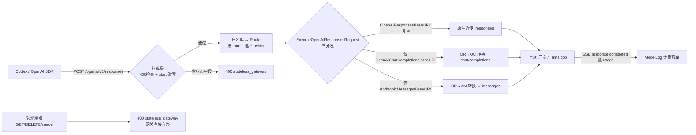

# Proposal

## Why

本网关面向编程 Agent，当前只代理两种对话协议（OpenAI Chat Completions、Anthropic Messages）。Codex CLI 自 2026-02 起只说 Responses 协议（`wire_api = "responses"`），网关缺失 `/responses` 端点导致 Codex 及新一代 OpenAI SDK 客户端无法接入；而上游条件已成熟——千问（`compatible-mode/v1/responses`）、智谱（`api/v1/responses`）、MiMo、混元部分模型及 llama.cpp 均提供原生 Responses 端点，DeepSeek/Kimi 等 chat-only 上游则可通过跨协议转换接入。

## What Changes

- 新增主端点 `POST /openai/v1/responses`，挂载现有 `RequireAPIKey` 中间件，按 model 走现有白名单与路由体系
- **强制无状态拦截层**（路由前，网关级）：请求含 `previous_response_id`、`conversation`、`background` 之一即返回 400 结构化错误（`code: stateless_gateway`）；`store` 字段无条件改写为 `false` 后透传——状态要么在上游要么在客户端，网关永远不持有，这也是跨协议转换可行的前提（全量回放使转换退化为纯函数）
- **管理端点由网关应答**：`GET/DELETE /responses/{id}`、`POST /responses/{id}/cancel`、`GET /responses/{id}/input_items` 及 `/conversations` 族注册路由但不转发，统一返回 400 + OpenAI 风格错误体（`code: stateless_gateway`，message 指导 agent 改用 `store:false` 全量回放）——与拦截层同为 400，网关级拒绝状态码统一
- **9 格协议矩阵**（3 客户端协议 × 3 上游方言）：3 格原生透传 + 2 格既有转换（OC↔AM，现有 OC2AM/AM2OC 代码原地复用）+ 4 格新转换（OR↔OC、OR→AM、OC→OR、AM→OR，每格含请求翻译、响应翻译、SSE 事件流翻译）
- **BREAKING（仅内部接口）**：`provider.Provider` 接口方法按外部产品名定名——`ExecuteOpenAIChatCompletionsRequest`、`ExecuteAnthropicMessagesRequest`、`ExecuteOpenAIResponsesRequest`（原 `ExecuteOpenAIRequest`/`ExecuteAnthropicRequest` 改名，纯编译期兜底，调用点 `proxy_openai`/`proxy_anthropic`/`model_testing` 同步，逻辑零改动）
- **BREAKING（仅内部接口）**：`provider-multi-style` 双 BaseURL 扩展为三 BaseURL——新增 `OpenAIResponsesBaseURL`。理由：国内厂商 responses 前缀与 chat 不一致（智谱 chat 在 `/api/paas/v4`、responses 在 `/api/v1`），无法从 `OpenAIChatCompletionsBaseURL` 拼出，必须独立配置；该字段非空即代表原生 Responses 能力
- **BREAKING（字段词表统一）**：三个 BaseURL 字段全链按外部产品名改名——DB 列、Go 字段、API JSON、前端表单同一词表：`openai_base_url` → `openai_chat_completions_base_url`、`anthropic_base_url` → `anthropic_messages_base_url`、新增 `openai_responses_base_url`。不写新旧列名兼容读取；存量列重命名 DDL 由运维上线前手动执行
- **方言分发权重**：每行规则统一为"原生优先 → 按 Chat > Anthropic > Responses 顺位选择转换目标"，9 格均有真实触发条件（`OpenAIResponsesBaseURL`-only 上游激活 OC→OR/AM→OR；未填 `OpenAIResponsesBaseURL` 的 OpenAI 风格上游触发 OR→OC）
- **范围排除**（经评估不做）：状态存储与 ID 映射（违背无状态原则）、404 运行时回退魔法（显式配置优于猜测）、`Execute(spec)` 接口重构（9 格直转下按产品名加方法即可，YAGNI）、codec 注册表

## Capabilities

### New Capabilities

- `openai-responses-api`: OpenAI Responses 兼容代理端点的对外行为——Bearer 鉴权、Key 模型白名单、按 model 路由、原生透传与跨协议转换（OR→OC/OR→AM）、强制无状态拦截（400 错误契约、`store:false` 改写）、管理端点结构化 400、SSE 流式与 Token 用量统计

### Modified Capabilities

- `provider-multi-style`: 双 BaseURL 模型扩展为三 BaseURL——需求"同时配置 OpenAI 风格和 Anthropic 风格"扩为含 Responses 风格；三个字段按产品名词表全链改名（DB 列/Go 字段/JSON/前端，无自动兼容）；Provider API 响应暴露字段、Config 结构、"至少一个 BaseURL"校验、模型同步端点选择（OpenAI → Anthropic → Responses 兜底）随之扩展

（调研确认：`provider-metadata`（主页/付费类型）、`provider-model-sync`（三态状态机）、`usage-tracking`（记录每次调用已覆盖）、`model-testing`（复用 Provider 逻辑不变）均不受影响，不列入。）

## Impact

- **代码**：`server/internal/provider/`（`provider.go` 接口改名、`provider_openai.go`/`provider_anthropic.go` 改名与方法搬移、`provider_automated.go` 增分支、新增 `provider_openai_responses.go`）、`server/internal/handler/`（`proxy_openai.go`/`proxy_anthropic.go` 按产品名改名为 `proxy_openai_chat_completions.go`/`proxy_anthropic_messages.go`、新增 `proxy_openai_responses.go` 承载 Responses handler + 拦截层 + 管理端点、`model_testing.go` 调用点改名）、`server/cmd/server/main.go`（新路由）、`server/internal/model/db.go` 与 `handler/provider.go`、`handler/model.go`、`router/`（三字段改名）、管理后台 `web/src/views/Providers/index.vue`（表单与字段改名 + Responses BaseURL 输入）
- **对外 API**：新增 1 个主端点 + 5 类管理端点（网关应答，不转发）；现有 `chat/completions`、`messages`、MCP、管理后台接口行为不变（需回归）
- **运维**：**上线前手动执行两列重命名 DDL**（`ALTER TABLE ... RENAME COLUMN`），代码不读旧列名、无兼容层——顺序必须"先改列、后部署"，否则启动即读不到字段；存量 Provider 若上游已支持 Responses（千问/智谱/MiMo 等）需补填 `openai_responses_base_url` 才走原生，不填则安全降级为协议转换；智谱类前缀不一致的上游不填即错误
- **依赖**：无新增第三方依赖
- **统计**：Responses usage 为 `input_tokens/output_tokens`，需映射进现有 `model_logs` 的 token 字段；流式需从 `response.completed` 事件抓取
